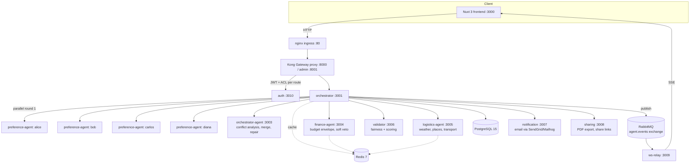

# itinera

Multi-agent AI group travel planner — an academic MVP studying multi-agent
negotiation patterns. A group of AI agents, each representing a different
traveler persona, negotiate a shared trip itinerary through an iterative,
round-based protocol until they converge on a plan the whole group can live
with (or agree to disagree, explicitly).

Sister project: `colloquio` (a separate fullstack monorepo — Vue 3, Go
microservices, Flutter, PostgreSQL, Pub/Sub). Not part of this repo.

## What it does

A user creates a trip (destination, dates or "N days available", budget,
travelers). Each traveler is represented by one of four fixed AI personas:

| Persona | Focus | Accent color |
|---|---|---|
| Alice | culture / museums / vegan | green |
| Bob | relaxation / beach | amber |
| Carlos | action / hiking | blue |
| Diana | gastronomy / fine dining | magenta |

The four preference agents run in parallel to produce initial proposals.
An orchestrator-agent resolves conflicts between them and merges a single
itinerary. A finance-agent checks the result against the group's budget
(soft veto, not a hard block — it will approve up to a tolerance and ask for
a targeted repair if it's over). A logistics-agent grounds the plan in
reality: weather, opening hours, local holidays/closures, and real
transport (flights, transit, driving). A validator scores the final result
for fairness and constraint compliance. All of this is driven by a single
backend state machine (the `WorkflowEngine`) and streamed live to an admin
view over Server-Sent Events, so a negotiation round can be watched as it
happens rather than just inspected after the fact.

## Technical diagram



Preference-agent, orchestrator-agent, finance-agent, and logistics-agent all
call the Anthropic API for the LLM-driven parts of their work; validator,
notification, sharing, ws-relay, and auth are deterministic services with
no LLM dependency. See each service's own README for the exact split.

## Tech stack

| Layer | Choice |
|---|---|
| Backend | Node.js + TypeScript (strict mode) |
| Frontend | Nuxt 3 + Vue 3 + TailwindCSS + Pinia |
| Gateway | Kong (proxy :8000, admin :8001) — JWT + ACL per route |
| Database | PostgreSQL 15, TypeORM migrations |
| Cache | Redis 7 |
| Queue | RabbitMQ 3.12 (topic exchange `agent.events`) |
| AI provider | Anthropic Claude, behind a provider-agnostic `IAIProvider` interface |
| Testing | Vitest (not Jest) |
| Real-time admin feed | RabbitMQ → ws-relay → Server-Sent Events |
| PDF export | Puppeteer (headless Chromium) |
| Containerization | Docker Compose, `services` profile for backend agents |
| Mail (dev) | Mailhog |
| Package management | Yarn Classic workspaces (`services/*`, `apps/*`, `tests/*`) |

## Key design decisions

- **State-machine negotiation, not a fixed round loop.** The engine is a
  `WorkflowStateMachine` + `WorkflowEngine`
  (`services/orchestrator/src/services/`) walking a fixed pipeline:
  `LOGISTICS_PLANNING → FINANCE_ENVELOPE_CHECK → PARALLEL_TURISTIC_PLANNING →
  MERGE_AND_SCORE → FINANCE_VALIDATE ⇄ ITINERARY_REPAIR → FINAL_VALIDATION →
  FINISH`, with `ASK_REFINEMENT` as the only other terminal state. There is
  no older "N negotiation rounds" design in the current codebase.
- **Budget is a soft constraint with a bounded repair loop.** Finance
  approves up to `BUDGET_TOLERANCE_PCT` (default 10%) over budget. Beyond
  that, the orchestrator asks for a *targeted edit list* against the
  existing itinerary rather than a full re-merge — this cuts token cost
  roughly 20x per repair cycle (~8k vs ~170k tokens). Retries per module are
  bounded by `WORKFLOW_MAX_RETRIES` (default 2).
- **Best-effort delivery over hard failure.** When the retry budget is
  exhausted but a complete itinerary exists, the trip still ships
  `confirmed`, with `workflow_context.overBudget` recorded rather than
  cancelling. Actual cancellations always persist a `rejection_reason`.
- **Provider-agnostic AI interface.** `IAIProvider` (in `services/shared`)
  is deliberately generic — no Anthropic-specific values (like raw
  `stop_reason` strings) leak into the shared type. Only `anthropic` is
  implemented today, but the abstraction doesn't assume it's the only one
  that ever will be.
- **Mock flags for paid external APIs.** Any service that calls a metered
  API (SerpAPI flights, Ticketmaster events, Google Places) supports a
  `*_MOCK=true` env flag returning fixture data, so local development
  doesn't burn quota. (Note: these are boolean env vars parsed via
  `z.coerce.boolean()`, which means the string `"false"` coerces to `true`
  — set them by omitting the var entirely, not by writing `false`.)
- **Kong is the single authorization boundary.** JWT + ACL plugins are
  attached per-route in `infrastructure/kong/configure.sh`; only the
  `auth` service's routes are public. The `iss` JWT claim selects which
  Kong consumer (and therefore which ACL group / rate limit) applies.
- **RabbitMQ is the only path to the live admin feed.** The orchestrator
  publishes every stage transition and agent action to the `agent.events`
  topic exchange; `ws-relay` is the sole consumer that bridges it to
  Server-Sent Events for the frontend. There's no other route by which the
  UI observes negotiation progress in real time.

## Repository layout

```
itinera-mvp-2026/
├── README.md                   # this file
├── CLAUDE.md                   # Claude Code project memory / conventions
├── Makefile                     # all local dev orchestration lives here
├── package.json                 # yarn workspaces root (services/*, apps/*, tests/*)
├── dev/
│   ├── docker-compose.yaml       # single compose file, "services" profile for backend agents
│   ├── .dev.env                  # non-secret defaults
│   ├── .secrets.env.example      # secrets template (copy to .secrets.env, fill in)
│   ├── init-databases.sh
│   └── nginx.conf                # local ingress on :80
├── docs/
│   ├── scenarios.md               # negotiation scenario test specs
│   └── proposals/                 # design proposals not yet implemented
├── infrastructure/
│   ├── kong/configure.sh          # idempotent Kong Admin API bootstrap
│   ├── postgres/init.sql          # bootstrap-only schema (TypeORM migrations are the real source of truth)
│   └── rabbitmq/                  # exchange/queue definitions
├── services/
│   ├── shared/                    # @itinera/shared — types, middleware, logger, AI provider abstraction
│   ├── auth/                      # Google OAuth login, JWT issuance
│   ├── orchestrator/               # negotiation engine (WorkflowEngine), trip CRUD, API surface
│   ├── preference-agent/           # alice / bob / carlos / diana personas
│   ├── orchestrator-agent/          # conflict analysis, propose, merge, repair
│   ├── finance-agent/               # budget validation (soft veto)
│   ├── logistics-agent/             # weather, places, transport, local restrictions
│   ├── validator/                   # fairness + constraint scoring (no LLM)
│   ├── notification/                # email (SendGrid/Mailhog), push/SMS stubs
│   ├── sharing/                     # PDF export, shareable links
│   └── ws-relay/                    # RabbitMQ → SSE bridge for the admin feed
├── apps/
│   └── frontend/                   # Nuxt 3 app (note: not `frontend/` at repo root)
└── tests/
    ├── scenarios/                   # end-to-end negotiation scenario tests (001-021)
    └── smoke/                       # smoke tests against a live `make dev` stack
```

Each service under `services/` and the `apps/frontend/` app has its own
`README.md` with implementation-level detail — see the index below.

## Quick start (local, Docker Compose)

```bash
# 1. Copy the secrets template and fill in real values
#    (Postgres/RabbitMQ passwords, JWT secret, ANTHROPIC_API_KEY, Google OAuth, etc.)
cp dev/.secrets.env.example dev/.secrets.env

# 2. Start everything: builds @itinera/shared, brings up all containers,
#    waits for Postgres, runs migrations, seeds data, configures Kong.
make dev
```

`make dev` runs, in order: `build-shared` → `docker compose up -d --profile
services` → wait for Postgres healthy → `db-migrate` → `db-seed` →
`kong-config`. `build-shared` matters even on repeat runs — services
bind-mount `services/shared/dist` read-only, so a fresh clone with an empty
`dist/` breaks every backend service until it's built once.

Once running:

| What | Where |
|---|---|
| App (via nginx ingress) | http://localhost |
| Frontend dev server directly | http://localhost:3000 |
| Kong proxy | http://localhost:8000 |
| Kong admin API | http://localhost:8001 |
| RabbitMQ management UI | http://localhost:15672 |
| Mailhog web UI (dev email) | http://localhost:8025 |

Other useful targets: `make infra` (Postgres/Redis/RabbitMQ only, no Kong),
`make up s=<service>` / `make stop s=<service>` / `make logs s=<service>`,
`make db-migrate`, `make db-seed`, `make down` (⚠ removes volumes too).
Run `make help` for the full, current list — it's generated from the
Makefile's own `##` comments, so it can't drift from what actually exists.

## Architecture highlights

- **Parallel first round.** All four preference agents run concurrently
  against the same trip brief — there's no persona ordering or turn-taking
  in round one.
- **Event-driven admin observability.** Every workflow state transition and
  every agent action publishes to RabbitMQ; nothing about the negotiation's
  progress is polled.
- **Bounded, targeted repair over full re-negotiation.** When a finished
  itinerary is over budget, the system edits it rather than starting over —
  see "Key design decisions" above.
- **Gateway-enforced auth, not per-service auth logic.** Individual backend
  services trust the JWT Kong already validated; they don't re-implement
  authentication.
- **Deterministic services stay deterministic.** `validator`, `ws-relay`,
  `notification`, `sharing`, and most of `logistics-agent`'s external-API
  work do not call an LLM at all — the LLM is reserved for the genuinely
  ambiguous parts (preference elicitation, conflict resolution, weather
  interpretation, budget negotiation phrasing).

## How to run tests

```bash
make test                 # all services, in Docker
make test s=<service>     # one service, in Docker
make test-unit            # unit tests only, in Docker (via orchestrator container)
make test-local s=<service>   # run a service's tests on the host, no Docker
make test-scenarios        # tests/scenarios — end-to-end negotiation scenarios
make test-smoke             # tests/smoke — requires `make dev` already running
```

Every service uses **Vitest**, not Jest. Unit tests live next to source in
each service's `src/__tests__/unit/`; scenario/e2e tests live in
`tests/scenarios/`.

## Service documentation index

| Service | Port | Purpose | Docs |
|---|---|---|---|
| auth | 3010 | Google OAuth login, JWT issuance | [services/auth/README.md](services/auth/README.md) |
| orchestrator | 3001 | Negotiation engine (`WorkflowEngine`), trip CRUD, API surface | [services/orchestrator/README.md](services/orchestrator/README.md) |
| preference-agent | 3002 | Alice/Bob/Carlos/Diana persona proposals | [services/preference-agent/README.md](services/preference-agent/README.md) |
| orchestrator-agent | 3003 | Conflict analysis, propose, merge, repair | [services/orchestrator-agent/README.md](services/orchestrator-agent/README.md) |
| finance-agent | 3004 | Budget validation (soft veto) | [services/finance-agent/README.md](services/finance-agent/README.md) |
| logistics-agent | 3005 | Weather, places, transport, local restrictions | [services/logistics-agent/README.md](services/logistics-agent/README.md) |
| validator | 3006 | Fairness + constraint scoring, no LLM | [services/validator/README.md](services/validator/README.md) |
| notification | 3007 | Email (SendGrid/Mailhog), push/SMS stubs | [services/notification/README.md](services/notification/README.md) |
| sharing | 3008 | PDF export, shareable links | [services/sharing/README.md](services/sharing/README.md) |
| ws-relay | 3009 | RabbitMQ → SSE bridge for the admin feed | [services/ws-relay/README.md](services/ws-relay/README.md) |
| shared | — (library) | Types, middleware, logger, AI provider abstraction | [services/shared/README.md](services/shared/README.md) |
| frontend | 3000 | Nuxt 3 app | [apps/frontend/README.md](apps/frontend/README.md) |

For contribution conventions (branch naming, commit style, code review
checklist, logging, secrets handling) see [`CLAUDE.md`](CLAUDE.md).
